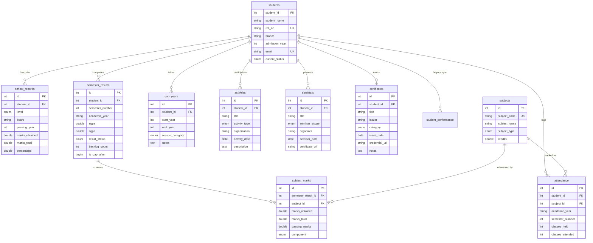

# ScholarTrack Database Schema & Relational Architecture Specification

## 1. Executive Summary & Normalization Architecture
The ScholarTrack database (`student_ledger`) implements a normalized **Third Normal Form (3NF)** relational database architecture deployed on MySQL 8.0+.
It is designed to systematically track higher education student profiles, historical schooling (SSC/HSC), semester-wise progression (SGPA/CGPA), curricular subjects and mark breakdowns, lecture attendance metrics, academic gap years, and co-curricular portfolios (activities, seminars, certifications).

### 3NF Compliance Principles Enforced:
1. **1NF (Atomic Values & Unique Records):** Every field stores atomic scalar values (no comma-delimited strings of subjects, marks, or certificate links). Every table possesses a dedicated primary key (`id` or `student_id`).
2. **2NF (No Partial Functional Dependencies):** All non-key attributes are fully functionally dependent on the entire primary key. In composite unique tables (such as `school_records`, `subject_marks`, `attendance`), secondary records depend on their own surrogate primary key while maintaining strict composite uniqueness constraints.
3. **3NF (No Transitive Dependencies):** Subject metadata (names, types, credit weights) is stored once in the `subjects` catalog. Grades and marks link to `subjects.id` without duplicating subject descriptions across mark sheets.

---

## 2. Entity Relationship Overview

---

## 3. Detailed Table Dictionary & Integrity Rules

### 3.1 `students`
- **Primary Key:** `student_id` (INT AUTO_INCREMENT)
- **Attributes:**
  - `student_name` VARCHAR(150) NOT NULL
  - `roll_no` VARCHAR(50) NOT NULL UNIQUE
  - `branch` VARCHAR(100) NOT NULL
  - `admission_year` INT NOT NULL
  - `email` VARCHAR(150) UNIQUE
  - `current_status` ENUM('Active', 'Graduated', 'On Hold', 'Discontinued') NOT NULL DEFAULT 'Active'
  - `created_at`, `updated_at` TIMESTAMP
- **Constraints & Indexes:**
  - `CONSTRAINT chk_admission_year CHECK (admission_year >= 1900 AND admission_year <= 2100)`
  - Indexes: `idx_students_roll_no`, `idx_students_name`, `idx_students_branch`

### 3.2 `school_records`
- **Primary Key:** `id` (INT AUTO_INCREMENT)
- **Foreign Key:** `student_id` REFERENCES `students(student_id)` ON DELETE CASCADE
- **Attributes:**
  - `level` ENUM('SSC', 'HSC') NOT NULL
  - `board` VARCHAR(100) NOT NULL
  - `passing_year` INT NOT NULL
  - `marks_obtained` DOUBLE NOT NULL
  - `marks_total` DOUBLE NOT NULL
  - `percentage` DOUBLE NOT NULL
- **Constraints & Indexes:**
  - `CONSTRAINT uk_student_school_level UNIQUE (student_id, level)`
  - `CONSTRAINT chk_school_marks CHECK (marks_obtained >= 0 AND marks_obtained <= marks_total AND marks_total > 0)`
  - `CONSTRAINT chk_school_percentage CHECK (percentage >= 0.0 AND percentage <= 100.0)`

### 3.3 `semester_results`
- **Primary Key:** `id` (INT AUTO_INCREMENT)
- **Foreign Key:** `student_id` REFERENCES `students(student_id)` ON DELETE CASCADE
- **Attributes:**
  - `semester_number` INT NOT NULL
  - `academic_year` VARCHAR(20) NOT NULL
  - `sgpa` DOUBLE NOT NULL
  - `cgpa` DOUBLE NOT NULL
  - `result_status` ENUM('Pass', 'ATKT', 'Fail', 'Pending') NOT NULL DEFAULT 'Pass'
  - `backlog_count` INT NOT NULL DEFAULT 0
  - `is_gap_after` TINYINT(1) NOT NULL DEFAULT 0
- **Constraints & Indexes:**
  - `CONSTRAINT uk_student_semester UNIQUE (student_id, semester_number)`
  - `CONSTRAINT chk_semester_number CHECK (semester_number >= 1 AND semester_number <= 10)`
  - `CONSTRAINT chk_sgpa CHECK (sgpa >= 0.0 AND sgpa <= 10.0)`
  - `CONSTRAINT chk_cgpa CHECK (cgpa >= 0.0 AND cgpa <= 10.0)`
  - `CONSTRAINT chk_backlogs CHECK (backlog_count >= 0)`

### 3.4 `subjects`
- **Primary Key:** `id` (INT AUTO_INCREMENT)
- **Attributes:**
  - `subject_code` VARCHAR(50) NOT NULL UNIQUE
  - `subject_name` VARCHAR(150) NOT NULL
  - `subject_type` ENUM('Theory', 'Lab') NOT NULL
  - `credits` DOUBLE NOT NULL DEFAULT 3.0
- **Constraints:**
  - `CONSTRAINT chk_subject_credits CHECK (credits >= 0.0 AND credits <= 10.0)`

### 3.5 `subject_marks`
- **Primary Key:** `id` (INT AUTO_INCREMENT)
- **Foreign Keys:**
  - `semester_result_id` REFERENCES `semester_results(id)` ON DELETE CASCADE
  - `subject_id` REFERENCES `subjects(id)` ON DELETE RESTRICT
- **Attributes:**
  - `marks_obtained` DOUBLE NOT NULL
  - `marks_total` DOUBLE NOT NULL DEFAULT 100.0
  - `passing_marks` DOUBLE NOT NULL DEFAULT 40.0
  - `component` ENUM('Internal', 'External', 'Practical', 'Final') NOT NULL DEFAULT 'Final'
- **Constraints:**
  - `CONSTRAINT uk_sem_subject UNIQUE (semester_result_id, subject_id, component)`
  - `CONSTRAINT chk_marks_obtained CHECK (marks_obtained >= 0 AND marks_obtained <= marks_total AND marks_total > 0)`

### 3.6 `attendance`
- **Primary Key:** `id` (INT AUTO_INCREMENT)
- **Foreign Keys:**
  - `student_id` REFERENCES `students(student_id)` ON DELETE CASCADE
  - `subject_id` REFERENCES `subjects(id)` ON DELETE RESTRICT
- **Attributes:**
  - `academic_year` VARCHAR(20) NOT NULL
  - `semester_number` INT NOT NULL
  - `classes_held` INT NOT NULL
  - `classes_attended` INT NOT NULL
- **Constraints:**
  - `CONSTRAINT uk_student_subject_attendance UNIQUE (student_id, subject_id, academic_year, semester_number)`
  - `CONSTRAINT chk_classes_held CHECK (classes_held >= 0)`
  - `CONSTRAINT chk_classes_attended CHECK (classes_attended >= 0 AND classes_attended <= classes_held)`

### 3.7 `gap_years`
- **Primary Key:** `id` (INT AUTO_INCREMENT)
- **Foreign Key:** `student_id` REFERENCES `students(student_id)` ON DELETE CASCADE
- **Attributes:**
  - `start_year` INT NOT NULL
  - `end_year` INT NOT NULL
  - `reason_category` ENUM('Academic', 'Medical', 'Personal', 'Other') NOT NULL
  - `notes` TEXT
- **Constraints:**
  - `CONSTRAINT chk_gap_years CHECK (end_year >= start_year AND start_year >= 1990)`

### 3.8 `activities`
- **Foreign Key:** `student_id` REFERENCES `students(student_id)` ON DELETE CASCADE
- **Attributes:** `title`, `activity_type` ('Technical', 'Co-curricular', 'Extra-curricular'), `organization`, `activity_date`, `description`

### 3.9 `seminars`
- **Foreign Key:** `student_id` REFERENCES `students(student_id)` ON DELETE CASCADE
- **Attributes:** `title`, `seminar_scope` ('Internal', 'External'), `organizer`, `seminar_date`, `certificate_url`

### 3.10 `certificates`
- **Foreign Key:** `student_id` REFERENCES `students(student_id)` ON DELETE CASCADE
- **Attributes:** `title`, `issuer`, `category` ('Course', 'Hackathon', 'Internship', 'Achievement', 'Seminar', 'Other'), `issue_date`, `credential_url`, `notes`

### 3.11 Legacy Table `student_performance`
- Preserved for backwards compatibility with early prototype scripts.
- Maintained through non-destructive synchronization (`database/migrations/002_migrate_legacy_performance.sql` and `/api/admin/migrate-legacy`).

---

## 4. Referential Action Justification
- **ON DELETE CASCADE** on student-owned records: When a student record is removed, all dependent marks, semester transcripts, attendance, and portfolio logs are systematically and cleanly purged without leaving orphan entries.
- **ON DELETE RESTRICT** on `subjects`: A subject catalog entry cannot be deleted if any student mark sheet or attendance record references it. This prevents historical transcripts from having invalid missing course links.
